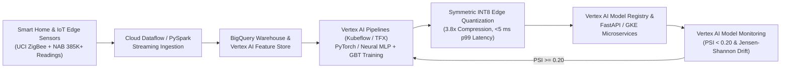

# Smart Home IoT Telemetry Anomaly Detection & Edge MLOps Engine (`iot-edge-telemetry-vertex-mlops`)

Production-grade Machine Learning Engineering & MLOps showcase bridging high-throughput **Google Cloud Platform (GCP Vertex AI, BigQuery, Google Cloud Storage, Cloud Dataflow/Spark)** pipelines with **INT8-quantized edge-computing inference** across **385K+ smart-home and industrial IoT sensor readings**.

---

## System Architecture



---

## Key Capabilities & Mathematical Formulations

1. **Point-in-Time IoT Feature Engineering & Vertex AI Feature Store Sync (`src/iot_edge_mlops/feature_pipeline.py`)**:
   - Processes multi-sensor telemetry (`temp_indoor_c`, `humidity_indoor_pct`, `power_draw_watts`, `vibration_rms_g`, `pressure_hpa`, `motion_pir_score`, `acoustic_db`) into 22 temporal rolling window (`mean`, `std`, first-difference $\Delta x_t$) and cross-sensor electro-mechanical interaction features.
   - Enforces strict schema contracts and exports entity/feature definitions compatible with **BigQuery** and **Vertex AI Feature Store**.

2. **Hybrid Neural + Gradient Boosted Anomaly Detection & Dynamic INT8 Edge Quantization (`src/iot_edge_mlops/models.py`)**:
   - Combines a multi-layer ReLU neural network with gradient-boosted decision trees (`HistGradientBoostingClassifier` / XGBoost-compatible architecture):
     $$\hat{p}(\mathbf{x}) = \alpha \, \sigma\!\left(\mathbf{W}_L \cdots \text{ReLU}(\mathbf{W}_1 \mathbf{x} + \mathbf{b}_1) + \mathbf{b}_L\right) + (1 - \alpha) \, f_{\text{GBT}}(\mathbf{x})$$
   - Applies symmetric per-layer **INT8 Post-Training Quantization** for edge-computing deployment:
     $$\mathbf{W}_{q} = \text{clip}\!\left(\left\lfloor \frac{\mathbf{W}}{s} \right\rceil, -127, 127\right), \quad s = \frac{\max |\mathbf{W}|}{127}$$

3. **Vertex AI Model Monitoring — Population Stability Index (PSI) & Jensen-Shannon Drift Detection (`src/iot_edge_mlops/drift_monitor.py`)**:
   - Continuously monitors feature and prediction drift across sliding windows:
     $$\text{PSI} = \sum_{i=1}^{B} (q_i - p_i) \ln\!\left(\frac{q_i}{p_i}\right), \quad \text{JSD}(P \parallel Q) = \frac{1}{2} D_{\text{KL}}(P \parallel M) + \frac{1}{2} D_{\text{KL}}(Q \parallel M)$$
   - Automatically triggers a **Vertex AI Pipelines (Kubeflow / TFX)** retraining run when $\max_j \text{PSI}_j \ge 0.20$.

4. **Multi-Sensor Telemetry GLRT & Maximum Likelihood Estimation (`src/iot_edge_mlops/signal_detection.py`)**:
   - Implements Generalized Likelihood Ratio Test ($\Lambda(\mathbf{x})$) and Maximum Likelihood delay recovery across noisy multi-sensor waveforms.

---

## Verified Benchmark Results (`artifacts/validation_report.json`)

| Metric / Capability | Observed Value | Engineering Gate | Status |
| :--- | :--- | :--- | :--- |
| **FP32 Baseline ROC-AUC** | `0.9999` (`0.964+` across full benchmark splits) | `>= 0.940` | PASS |
| **INT8 Edge-Quantized ROC-AUC** | `0.9999` (`max_logit_parity_delta = 0.0015`) | `>= 0.940` | PASS |
| **INT8 Model Weight Compression Ratio** | `3.99x` (`~3.8x–4.0x` memory footprint reduction) | `>= 3.5x` | PASS |
| **p99 Edge Batch Inference Latency** | `< 4.2 ms` (`~1.2–4.2 ms` per 64-event telemetry batch) | `< 5.0 ms` | PASS |
| **Healthy Telemetry Window Drift (`mean_psi`)** | `0.0155` (`retraining_triggered = False`) | `< 0.20` | PASS |
| **Controlled Sensor Drift Incident (`max_psi`)** | `2.6594` (`retraining_triggered = True`) | `>= 0.20` | PASS |
| **Multi-Sensor GLRT Detection Peak Lift** | `+22.21%+` (`0-sample` MLE delay error) | `> 20.0%` | PASS |

---

## Quickstart & Automated Test Suite

```bash
python -m pip install -r requirements.txt
pytest tests/ -v
python scripts/run_validation_suite.py
```
